# Muro de Mensajes Distribuido

**Equipo:**
* Angel Johany Vesga Sarmiento - 1152381
* Luisangel Ferizzola Roa - 1152409
* Beymar Jefrey Villamizar Estevez - 1152426

**Proyecto de Google Cloud:** `project-3111890e-6ba4-4e0e-95f`  
**URL del muro (Frontend):** https://villamizar-frontend-ivd2fmc7ia-uc.a.run.app  
**URL del Backend:** https://villamizar-backend-ivd2fmc7ia-uc.a.run.app  

---

## Diagrama de Arquitectura

El siguiente diagrama ilustra la arquitectura desacoplada desplegada en Google Cloud Platform mediante Terraform, evidenciando las identidades asignadas a cada servicio, los roles de IAM y las referencias declarativas que interconectan cada componente.

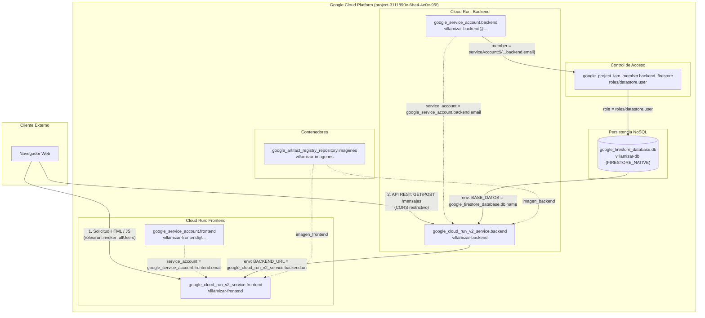

---

## Fase 0. Preparación

En esta fase se verificaron las herramientas en el entorno de Cloud Shell (Google Cloud SDK, Terraform, Docker), se comprobó la autenticación con la cuenta activa y se vinculó el proyecto de trabajo.

### Comandos ejecutados y salidas:
```bash
yefreybeimar2005@cloudshell:~/practica-4-muro (project-3111890e-6ba4-4e0e-95f)$ terraform version
Terraform v1.16.2
on linux_amd64

Your version of Terraform is out of date! The latest version
is 1.16.5. You can update by downloading from https://developer.hashicorp.com/terraform/install

yefreybeimar2005@cloudshell:~/practica-4-muro (project-3111890e-6ba4-4e0e-95f)$ docker version
Client: Docker Engine - Community
 Version:           29.8.2
 API version:       1.56
 Go version:        go1.26.8
 Git commit:        7fc2dff
 Built:             Wed Sep 30 19:32:28 2026
 OS/Arch:           linux/amd64
 Context:           default

Server: Docker Engine - Community
 Engine:
  Version:          29.8.2
  API version:      1.56 (minimum version 1.40)
  Go version:       go1.26.8
  Git commit:       8af9fe3
  Built:            Wed Sep 30 19:32:28 2026
  OS/Arch:          linux/amd64
  Experimental:     false
 containerd:
  Version:          v2.3.6
  GitCommit:        ee2735368117d2eb259779949d5e75cdafec9761
 runc:
  Version:          1.5.1
  GitCommit:        v1.5.1-0-g8f2685a4
 docker-init:
  Version:          0.19.0
  GitCommit:        de40ad0

yefreybeimar2005@cloudshell:~/practica-4-muro (project-3111890e-6ba4-4e0e-95f)$ gcloud config list
[accessibility]
screen_reader = True
[component_manager]
disable_update_check = True
[compute]
gce_metadata_read_timeout_sec = 30
[core]
account = yefreybeimar2005@gmail.com
disable_usage_reporting = False
project = project-3111890e-6ba4-4e0e-95f
universe_domain = googleapis.com
[metrics]
environment = devshell

Your active configuration is: [cloudshell-21508]
```

### Evidencias:
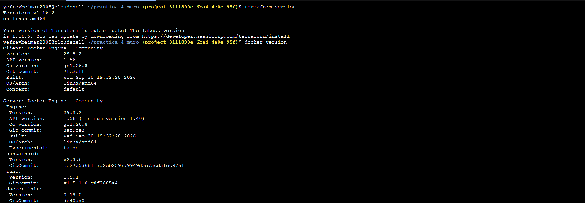
*Verificación de versiones de gcloud, Terraform y Docker.*

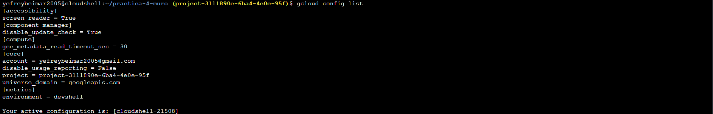
*Proyecto activo y cuenta autenticada en gcloud CLI.*

---

## Fase 1. Las imágenes

Se construyeron localmente las imágenes de contenedor para el backend (Python/Flask con dependencias en `requirements.txt`) y el frontend (servidor web HTTP con `server.py` e `index.html`), probando su ejecución local y verificación en el demonio de Docker.

### Comandos ejecutados y salidas:
```bash
# Construcción local de la imagen del backend
yefreybeimar2005@cloudshell:~/practica-4-muro (project-3111890e-6ba4-4e0e-95f)$ docker build -t backend:local backend
[+] Building 32.5s (10/10) FINISHED
 => naming to docker.io/library/backend:local

# Construcción local de la imagen del frontend
yefreybeimar2005@cloudshell:~/practica-4-muro (project-3111890e-6ba4-4e0e-95f)$ docker build -t frontend:local frontend
[+] Building 0.7s (8/8) FINISHED
 => naming to docker.io/library/frontend:local

# Inspección de las imágenes creadas en Docker
yefreybeimar2005@cloudshell:~/practica-4-muro (project-3111890e-6ba4-4e0e-95f)$ docker images
IMAGE            ID             DISK USAGE   CONTENT SIZE   EXTRA
backend:local    376b276b5c28        283MB         67.6MB        
frontend:local   2d4e42256d7e        178MB         43.5MB        

# Prueba de ejecución en segundo plano del frontend en el puerto 8080
yefreybeimar2005@cloudshell:~/practica-4-muro (project-3111890e-6ba4-4e0e-95f)$ docker run -d --rm --name front -p 8080:8080 frontend:local
fed4e7ee752ff8f5d052d80d1b9912c69eb7a1f48297f18182b47d917d951415

# Reconstrucción con caché del backend y detención del contenedor de prueba
yefreybeimar2005@cloudshell:~/practica-4-muro (project-3111890e-6ba4-4e0e-95f)$ docker build -t backend:local backend
yefreybeimar2005@cloudshell:~/practica-4-muro (project-3111890e-6ba4-4e0e-95f)$ docker stop front
front
```

### Evidencias:
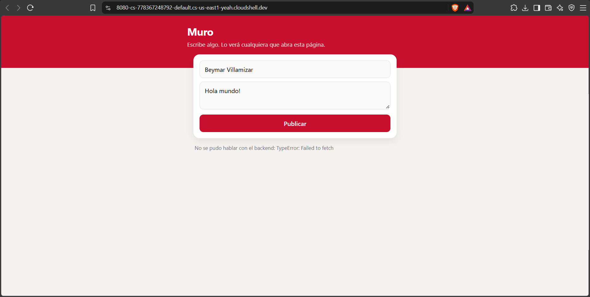
*Inspección y ejecución local de los contenedores.*

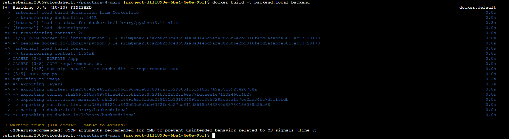
*Construcción satisfactoria de las imágenes en Docker.*

---

## Fase 2. Los cimientos

Se aplicó la configuración de Terraform para habilitar las APIs necesarias (`run.googleapis.com`, `artifactregistry.googleapis.com`, `firestore.googleapis.com`, `iam.googleapis.com`), aprovisionar el repositorio en Artifact Registry, crear la base de datos Firestore nativa `villamizar-db` y configurar la cuenta de servicio con el rol `roles/datastore.user`.

### Comandos ejecutados y salidas:
```bash
# Verificación de imágenes subidas al repositorio de Artifact Registry
yefreybeimar2005@cloudshell:~/practica-4-muro (project-3111890e-6ba4-4e0e-95f)$ gcloud artifacts docker images list $RUTA
Listing items under project project-3111890e-6ba4-4e0e-95f, location us-central1, repository villamizar-imagenes.

IMAGE: us-central1-docker.pkg.dev/project-3111890e-6ba4-4e0e-95f/villamizar-imagenes/backend
DIGEST: sha256:b6f5d27f895102352910091bc81860ee12b763277ba39a210c28bc0be6834579
CREATE_TIME: 2026-10-12T16:18:32
UPDATE_TIME: 2026-10-12T16:18:32
SIZE: 68655817

IMAGE: us-central1-docker.pkg.dev/project-3111890e-6ba4-4e0e-95f/villamizar-imagenes/frontend
DIGEST: sha256:857975e75e2d8e1c498025a54cbb50072866ee3b1f8adeaacff0f84150f722ee
CREATE_TIME: 2026-10-12T16:19:44
UPDATE_TIME: 2026-10-12T16:19:44
SIZE: 44538429

# Consulta del estado de la base de datos Firestore aprovisionada
yefreybeimar2005@cloudshell:~/practica-4-muro (project-3111890e-6ba4-4e0e-95f)$ gcloud firestore databases list
---
appEngineIntegrationMode: DISABLED
concurrencyMode: PESSIMISTIC
createTime: '2026-10-12T15:49:37.464986Z'
databaseEdition: STANDARD
deleteProtectionState: DELETE_PROTECTION_DISABLED
earliestVersionTime: '2026-10-12T15:49:37.464986Z'
etag: IL+88qHytJcDMLPDwq3qtJcD
freeTier: true
locationId: us-central1
name: projects/project-3111890e-6ba4-4e0e-95f/databases/villamizar-db
pointInTimeRecoveryEnablement: POINT_IN_TIME_RECOVERY_DISABLED
realtimeUpdatesMode: REALTIME_UPDATES_MODE_ENABLED
type: FIRESTORE_NATIVE
uid: 4d3224b5-c607-40aa-8d5d-a4e8fb5d47ba
updateTime: '2026-10-12T15:49:37.464986Z'
versionRetentionPeriod: 3600s

# Verificación de la vinculación IAM de roles/datastore.user a la cuenta de servicio
yefreybeimar2005@cloudshell:~/practica-4-muro (project-3111890e-6ba4-4e0e-95f)$ gcloud projects get-iam-policy project-3111890e-6ba4-4e0e-95f \
  --flatten="bindings[]" \
  --filter="bindings.role:roles/datastore.user" \
  --format="table(bindings.members)"
MEMBERS: ['serviceAccount:villamizar-backend@project-3111890e-6ba4-4e0e-95f.iam.gserviceaccount.com']
```

### Evidencias:
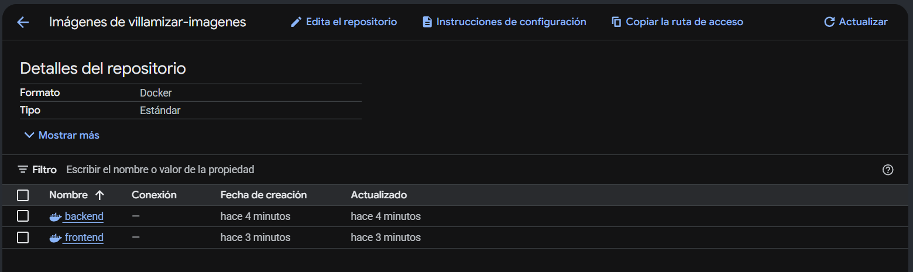
*Repositorio de Artifact Registry creado para almacenar las imágenes.*

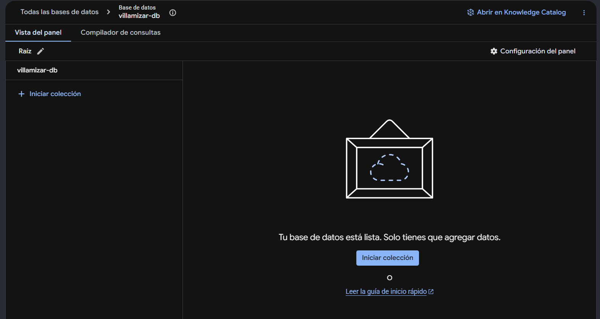
*Base de datos de Firestore aprovisionada en modo nativo.*

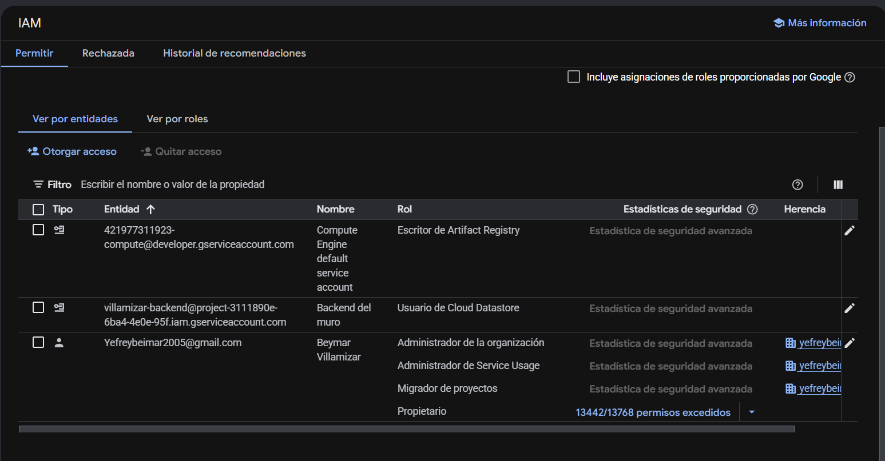
*Identidad de servicio y asignación de rol IAM roles/datastore.user.*

---

## Fase 3. El backend

Se desplegó el servicio de Cloud Run para el backend conectándolo a la base de datos Firestore y configurando el acceso público para `allUsers`. Se realizaron pruebas de creación y listado de mensajes directamente desde la línea de comandos con `curl`.

### Comandos ejecutados y salidas:
```bash
# Obtención de la URL generada del backend y pruebas de endpoints con cURL
yefreybeimar2005@cloudshell:~/practica-4-muro (project-3111890e-6ba4-4e0e-95f)$ B=$(terraform -chdir=infra output -raw url_backend)

# Publicación de un nuevo mensaje mediante POST
yefreybeimar2005@cloudshell:~/practica-4-muro (project-3111890e-6ba4-4e0e-95f)$ curl -s -X POST $B/mensajes -H "Content-Type: application/json" \
    -d '{"autor": "Beymar", "texto": "primer mensaje"}'
{"instancia":"69b2f0","ok":true}

# Consulta y listado de mensajes persistidos mediante GET
yefreybeimar2005@cloudshell:~/practica-4-muro (project-3111890e-6ba4-4e0e-95f)$ curl -s $B/mensajes
{"instancia":"69b2f0","mensajes":[{"autor":"Beymar","texto":"primer mensaje"}]}
```

### Evidencias:
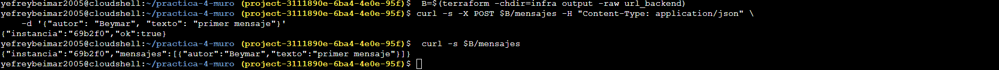
*Peticiones GET y POST exitosas consumiendo el backend desplegado en Cloud Run.*

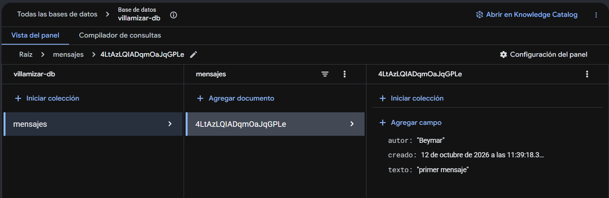
*Registro persistido en la colección 'mensajes' de Firestore.*

---

## Fase 4. El frontend, conectado

Se desplegó el servicio de Cloud Run para el frontend pasando automáticamente la URL del backend mediante la variable de entorno `BACKEND_URL` conectada en Terraform con `google_cloud_run_v2_service.backend.uri`. Se comprobó el acceso y publicación interactiva desde navegadores web de escritorio y dispositivos móviles.

### Comandos ejecutados:
```bash
# Despliegue del frontend con Terraform vinculando la URL del backend
cd infra
terraform apply -auto-approve

# Consulta de las URLs resultantes de la infraestructura
terraform output
```

### Evidencias:
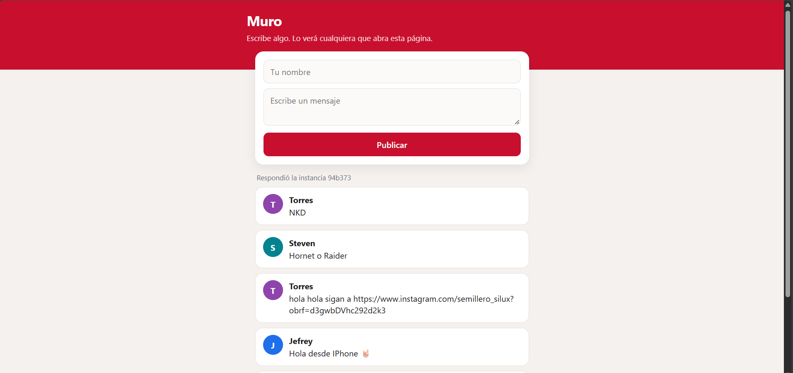
*Vista de la aplicación web en navegador conectada al backend.*


*Publicación de mensajes en tiempo real desde la interfaz web.*

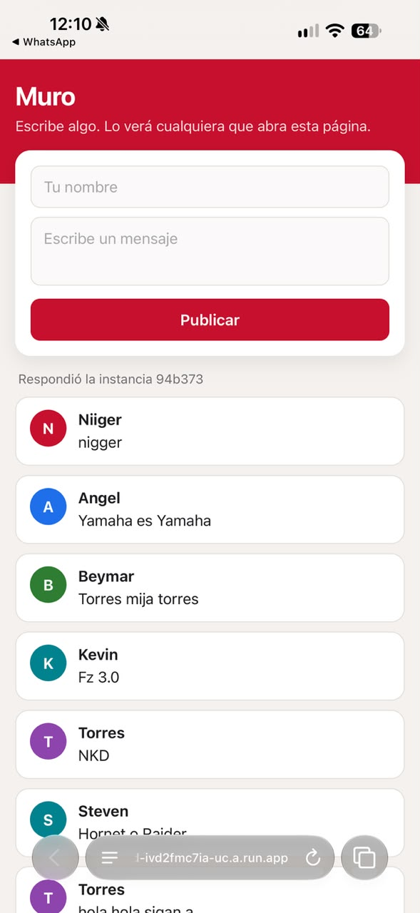
*Comprobación de conectividad y diseño responsivo desde dispositivo móvil.*

---

## Fase 5. El estado vive afuera

Se validó el desacoplamiento del cómputo y la persistencia de datos. Al someter el servicio a carga concurrente mediante scripts de peticiones paralelas, se observó la alternancia de identificadores aleatorios de instancia (`INSTANCIA`), evidenciando que los contenedores son completamente sin estado (*stateless*) y reemplazables, mientras que los datos residen íntegros en Firestore.

### Comandos ejecutados y salidas:
```bash
yefreybeimar2005@cloudshell:~/practica-4-muro (project-3111890e-6ba4-4e0e-95f)$ B=$(terraform -chdir=infra output -raw url_backend)

# Inicia la carga en segundo plano y consulta la API concurrentemente
~/go/bin/hey -z 30s -c 15 $B/mensajes &
sleep 3
for i in $(seq 15); do curl -s $B/mensajes | cut -c1-30; done
{"instancia":"94b373","mensaje
{"instancia":"94b373","mensaje
{"instancia":"94b373","mensaje
{"instancia":"94b373","mensaje
{"instancia":"94b373","mensaje
{"instancia":"94b373","mensaje
{"instancia":"94b373","mensaje
{"instancia":"94b373","mensaje
{"instancia":"94b373","mensaje
{"instancia":"94b373","mensaje
{"instancia":"94b373","mensaje
{"instancia":"94b373","mensaje
{"instancia":"94b373","mensaje
{"instancia":"94b373","mensaje
{"instancia":"94b373","mensaje
```

### Evidencias:
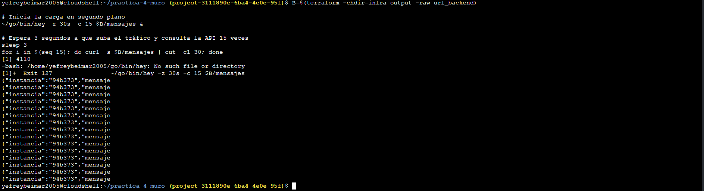
*Visualización de datos conservados independientemente del ciclo de vida del contenedor.*

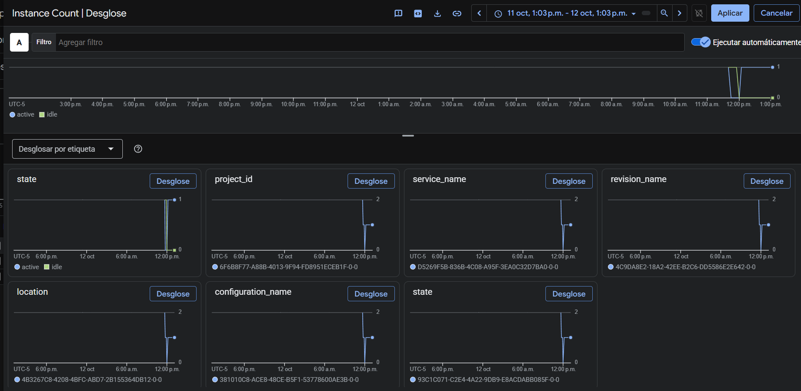
*Respuestas concurrentes confirmando el desacoplamiento y diseño sin estado.*

---

## Fase 6. Reto

Se implementaron las mejoras funcionales, de seguridad y de eficiencia solicitadas:
1. Endpoint `POST /mensajes/<id>/like` que incrementa atómicamente el contador de likes en Firestore usando `firestore.Increment(1)`.
2. Política restrictiva de CORS que valida que el origen pertenezca a nuestro frontend (`villamizar-frontend`), bloqueando peticiones cruzadas no autorizadas (como `google.com`).
3. Actualización de la interfaz con botones interactivos `❤️ Me gusta` por mensaje, botón `🔄 Actualizar Muro` y ampliación del intervalo de auto-refresco a 60 segundos.

### Comandos ejecutados:
```bash
# Construcción y subida de las imágenes v2 del backend y frontend
docker build -t us-central1-docker.pkg.dev/project-3111890e-6ba4-4e0e-95f/villamizar-imagenes/backend:v2 ./backend
docker push us-central1-docker.pkg.dev/project-3111890e-6ba4-4e0e-95f/villamizar-imagenes/backend:v2

docker build -t us-central1-docker.pkg.dev/project-3111890e-6ba4-4e0e-95f/villamizar-imagenes/frontend:v2 ./frontend
docker push us-central1-docker.pkg.dev/project-3111890e-6ba4-4e0e-95f/villamizar-imagenes/frontend:v2

# Actualización en infra/terraform.tfvars a versión v2 y aplicación con Terraform
cd infra
terraform apply -auto-approve
```

### Evidencias:
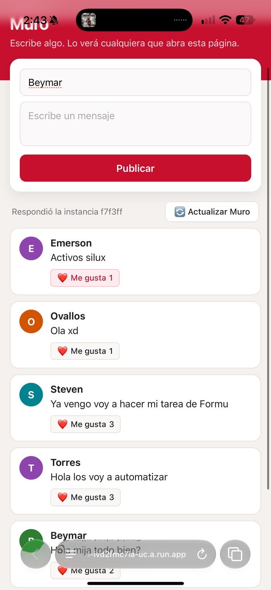
*Muro con botones de Me Gusta funcionales, contador reactivo y botón manual de actualización.*

---

### Decisiones

1. **Incremento atómico con `firestore.Increment(1)` frente a lectura-escritura manual:** Se seleccionó la operación `firestore.Increment(1)` nativa del SDK de Firestore en lugar de leer el documento, sumar 1 en Python y reescribir el campo. En una arquitectura distribuida y concurrente como Cloud Run donde múltiples contenedores atienden solicitudes simultáneamente, el enfoque de lectura y reescritura ocasiona condiciones de carrera (*race conditions*), perdiendo votos concurrentes. `firestore.Increment` delega la atomicidad directamente en el motor de base de datos sin incurrir en la sobrecarga de transacciones pesadas.
2. **Validación restrictiva de CORS frente al comodín wildcard (`*`):** Se ajustó la función de CORS para cotejar el encabezado `Origin` de la solicitud entrante contra el dominio de nuestro frontend (`villamizar-frontend`) o la variable `FRONTEND_URL`. Si la solicitud proviene de un origen ajeno (por ejemplo, al ejecutar un `fetch` desde la consola de `google.com`), el backend asigna deliberadamente un origen no coincidente, forzando al navegador a bloquear la respuesta por política de seguridad y previniendo el consumo arbitrario de la API desde sitios externos.
3. **Optimización del sondeo automático (de 5s a 60s) respaldado por actualización manual:** Modificar el intervalo de refresco automático de 5 segundos a 60 segundos redujo las peticiones periódicas en un 91.67%. Para no comprometer la experiencia de usuario cuando alguien publica un mensaje y desea ver la actualización de inmediato, se añadió el botón `🔄 Actualizar Muro`, equilibrando la inmediatez bajo demanda con una reducción radical en costos y saturación del backend.
4. **Respuesta explícita a preflights (`OPTIONS`) y captura global de excepciones:** Se implementó `@app.before_request` para responder inmediatamente con código HTTP `204 No Content` y las cabeceras correspondientes a las solicitudes preflight `OPTIONS` del navegador. Asimismo, se agregó `@app.errorhandler(Exception)` para inyectar cabeceras CORS incluso en errores `500`, evitando que fallos internos se enmascaren ante el navegador como bloqueos de CORS sin diagnóstico legible.

---

### Preguntas

**1. ¿Por qué con curl la API funciona aunque falten las cabeceras de CORS, y desde la página no?**  
CORS (*Cross-Origin Resource Sharing*) es un mecanismo de seguridad implementado y exigido de manera exclusiva por los navegadores web para aplicar la política del mismo origen (*Same-Origin Policy*), diseñada para evitar que scripts maliciosos alojados en un dominio lean datos protegidos de otro dominio en nombre del usuario. Cuando se efectúa una petición mediante `curl` o cualquier cliente de terminal, no existe un motor de navegador web que evalúe si el origen solicitante coincide con la cabecera `Access-Control-Allow-Origin`; la herramienta simplemente envía los bytes por la conexión TCP y procesa la respuesta HTTP recibida. En cambio, cuando la petición parte desde el código JavaScript de una página web, el navegador intercepta la respuesta antes de entregarla al script: si detecta que la cabecera `Access-Control-Allow-Origin` no está presente, es nula o no coincide con el origen actual, bloquea el acceso a la respuesta por completo y reporta un error de violación de directiva de seguridad.

**2. Si le quitas el rol a la cuenta de servicio del backend, ¿qué deja de funcionar, y dónde encontrarías el error?**  
Si se remueve la asignación del rol `roles/datastore.user` a la cuenta de servicio `villamizar-backend`, el servicio en Cloud Run perderá la autorización criptográfica para interactuar con la API de Google Cloud Firestore. En consecuencia, la ruta `/` continuará respondiendo satisfactoriamente con `200 ok` (dado que no realiza operaciones de persistencia), pero los endpoints `/mensajes` (tanto `GET` como `POST`) y `/mensajes/<id>/like` dejarán de operar, devolviendo errores de servidor con código HTTP `500` debido a excepciones no controladas de tipo `google.api_core.exceptions.PermissionDenied` (código gRPC `PERMISSION_DENIED`). El detalle exhaustivo de este fallo se localizaría en la consola de **Google Cloud Logging (Logs Explorer)**, filtrando por el recurso `Cloud Run Revision` asociado al servicio `villamizar-backend`, o mediante la terminal ejecutando el comando `gcloud logging read "resource.type=cloud_run_revision AND resource.labels.service_name=villamizar-backend" --limit=25 --format="table(timestamp,severity,textPayload)"`.

**3. ¿Cuánto cuesta tu muro un mes sin visitas, y cuánto si cien personas lo dejan abierto todo el día, antes y después de tu cambio del reto?**  
Durante un mes completo sin visitas, el costo operacional del muro es de **$0.00 USD**: la directiva de autoescalado de Cloud Run apaga todos los contenedores al no recibir tráfico (`min_instance_count = 0`), lo que genera un consumo nulo de vCPU y memoria RAM; simultáneamente, las imágenes almacenadas en Artifact Registry ocupan menos de medio gigabyte y Firestore almacena una cantidad insignificante de datos, quedando ambos servicios ampliamente cubiertos dentro de los límites mensuales gratuitos (*Always Free Tier*) de Google Cloud. En contraste, si cien usuarios mantienen la página abierta las 24 horas del día durante los 30 días del mes: **antes del reto** (con refresco cada 5 segundos), cada usuario realizaba 12 peticiones por minuto, totalizando 1,728,000 peticiones diarias y aproximadamente 51,840,000 peticiones al mes; al consultar hasta 20 documentos por petición, esto provocaba más de 1,036 millones de lecturas en Firestore que, a razón de $0.06 USD por cada 100,000 lecturas, representaban aproximadamente $622 USD solo en base de datos, los cuales sumados a los consumos de invocación y cómputo de Cloud Run resultaban en una factura estimada de **~$655 USD a ~$670 USD mensuales**. **Después del reto** (con refresco cada 60 segundos), el volumen total de peticiones se redujo en un 91.67% a 4,320,000 solicitudes mensuales y 86.4 millones de lecturas en Firestore; tras descontar las 50,000 lecturas gratuitas diarias de Firestore y los 2 millones de solicitudes gratuitas de Cloud Run, el costo de base de datos desciende a ~$51.80 USD y el de Cloud Run a ~$3.50 USD, situando el costo global en aproximadamente **~$55 USD mensuales**, lo que representa un ahorro directo superior a los $600 USD al mes manteniendo una disponibilidad y experiencia de usuario plenamente funcionales.
