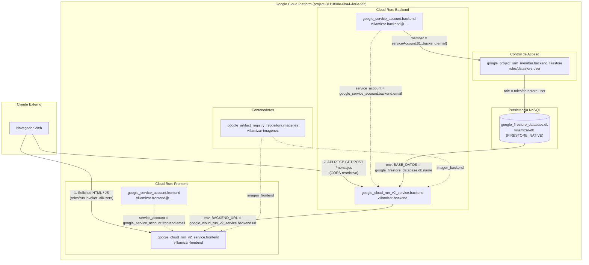
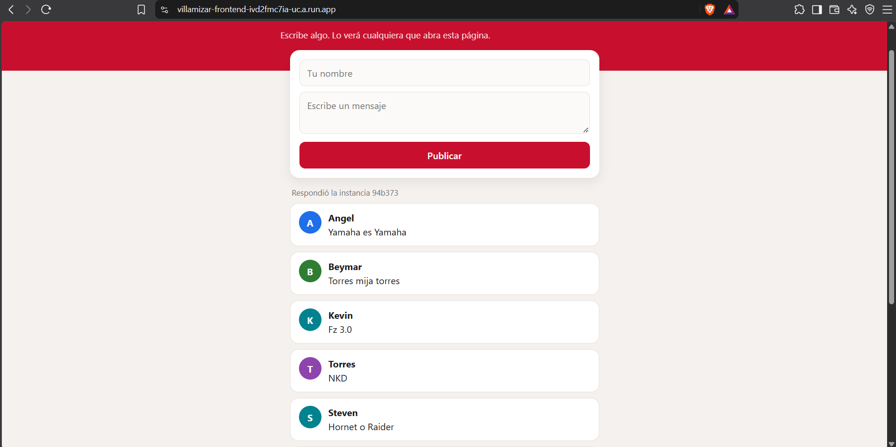

# Muro de Mensajes Distribuido

**Equipo:**
* Angel Johany Vesga Sarmiento - 1152381
* Luisangel Ferizzola Roa - 1152409
* Beymar Jefrey Villamizar Estevez - 1152426

**Proyecto de Google Cloud:** `project-3111890e-6ba4-4e0e-95f`  
**URL del muro (Frontend):** https://villamizar-frontend-ivd2fmc7ia-uc.a.run.app  
**URL del Backend:** https://villamizar-backend-ivd2fmc7ia-uc.a.run.app  

---

## Diagrama de Arquitectura

El siguiente diagrama ilustra la arquitectura desacoplada desplegada en Google Cloud Platform mediante Terraform, evidenciando las identidades asignadas a cada servicio, los roles de IAM y las referencias declarativas que interconectan cada componente.



---

## Fase 0. Preparación

En esta fase se verificaron las herramientas base en la máquina de desarrollo (Google Cloud SDK, Terraform, Docker), se autenticaron las credenciales contra Google Cloud y se vinculó el proyecto activo.

### Comandos ejecutados:
```bash
# Verificación de versiones instaladas
gcloud --version
terraform -version
docker --version

# Autenticación con Google Cloud y credenciales por defecto de aplicación
gcloud auth login
gcloud auth application-default login

# Configuración del proyecto de trabajo en la CLI
gcloud config set project project-3111890e-6ba4-4e0e-95f
gcloud config list
```

### Evidencias:

*Verificación de versiones de gcloud, Terraform y Docker.*


*Proyecto activo y cuenta autenticada en gcloud CLI.*

---

## Fase 1. Las imágenes

Se construyeron localmente las imágenes Docker para el backend (Flask) y el frontend (servidor web liviano en Python) para verificar empaquetado, dependencias y puertos de escucha antes del despliegue en la nube.

### Comandos ejecutados:
```bash
# Construcción local de la imagen del backend
docker build -t backend:v1 ./backend

# Construcción local de la imagen del frontend
docker build -t frontend:v1 ./frontend

# Verificación de imágenes construidas en el daemon local
docker images
```

### Evidencias:

*Inspección y ejecución local de los contenedores.*


*Construcción satisfactoria de las imágenes en Docker.*

---

## Fase 2. Los cimientos

Se inicializó y aplicó la infraestructura base con Terraform: habilitación de APIs de Google Cloud (`run.googleapis.com`, `artifactregistry.googleapis.com`, `firestore.googleapis.com`, `iam.googleapis.com`), creación del repositorio de Artifact Registry, base de datos de Firestore en modo nativo y creación de la cuenta de servicio del backend con el rol `roles/datastore.user`.

### Comandos ejecutados:
```bash
cd infra

# Inicialización de proveedores de Terraform
terraform init

# Planificación y creación de la infraestructura inicial
terraform plan
terraform apply -auto-approve

# Configuración del helper de autenticación de Docker para Artifact Registry
gcloud auth configure-docker us-central1-docker.pkg.dev
```

### Evidencias:

*Repositorio de Artifact Registry creado para almacenar las imágenes.*


*Base de datos de Firestore aprovisionada en modo nativo.*


*Identidad de servicio y asignación de rol IAM roles/datastore.user.*

---

## Fase 3. El backend

Se etiquetó y publicó la imagen del backend en Artifact Registry. Posteriormente se desplegó el servicio en Cloud Run mediante Terraform, configurando variables de entorno, concurrencia máxima y acceso público (`allUsers`). Se validó la API mediante llamadas directas con `curl`.

### Comandos ejecutados:
```bash
# Etiquetado de la imagen del backend para Artifact Registry
docker tag backend:v1 us-central1-docker.pkg.dev/project-3111890e-6ba4-4e0e-95f/villamizar-imagenes/backend:v1

# Subida de la imagen al repositorio remoto
docker push us-central1-docker.pkg.dev/project-3111890e-6ba4-4e0e-95f/villamizar-imagenes/backend:v1

# Despliegue del servicio Cloud Run del backend
cd infra
terraform apply -auto-approve

# Pruebas funcionales con curl
curl https://villamizar-backend-ivd2fmc7ia-uc.a.run.app/
curl -X POST https://villamizar-backend-ivd2fmc7ia-uc.a.run.app/mensajes \
  -H "Content-Type: application/json" \
  -d '{"autor": "Beymar", "texto": "Primer mensaje desde terminal"}'
curl https://villamizar-backend-ivd2fmc7ia-uc.a.run.app/mensajes
```

### Evidencias:

*Peticiones GET y POST exitosas consumiendo el backend desplegado en Cloud Run.*


*Registro persistido en la colección 'mensajes' de Firestore.*

---

## Fase 4. El frontend, conectado

Se etiquetó y subió la imagen del frontend a Artifact Registry. Se desplegó el servicio de Cloud Run para el frontend pasando automáticamente la URL del backend mediante la referencia de Terraform `google_cloud_run_v2_service.backend.uri`. Se comprobó el funcionamiento del muro desde el navegador de escritorio y desde un dispositivo móvil.

### Comandos ejecutados:
```bash
# Etiquetado y subida de la imagen del frontend
docker tag frontend:v1 us-central1-docker.pkg.dev/project-3111890e-6ba4-4e0e-95f/villamizar-imagenes/frontend:v1
docker push us-central1-docker.pkg.dev/project-3111890e-6ba4-4e0e-95f/villamizar-imagenes/frontend:v1

# Despliegue del frontend en Cloud Run
cd infra
terraform apply -auto-approve
```

### Evidencias:

*Vista de la aplicación web en navegador conectada al backend.*


*Publicación de mensajes en tiempo real desde la interfaz web.*


*Comprobación de conectividad y diseño responsivo desde dispositivo móvil.*

---

## Fase 5. El estado vive afuera

Se validó el desacoplamiento del estado entre el cómputo y la base de datos. Se forzó el escalado y reinicio de contenedores en Cloud Run para comprobar que la instancia del backend es efímera e intercambiable (el identificador aleatorio de instancia cambia en cada respuesta), mientras que la totalidad de los datos permanece intacta en Firestore.

### Comandos ejecutados:
```bash
# Generación de peticiones concurrentes para observar el cambio de instancias
curl https://villamizar-backend-ivd2fmc7ia-uc.a.run.app/mensajes
curl https://villamizar-backend-ivd2fmc7ia-uc.a.run.app/mensajes
```

### Evidencias:

*Visualización de datos conservados independientemente del ciclo de vida del contenedor.*


*Respuestas provenientes de identificadores de instancia distintos confirmando el diseño sin estado.*

---

## Fase 6. Reto

Se implementaron las mejoras funcionales, de seguridad y de eficiencia solicitadas:
1. Endpoint `POST /mensajes/<id>/like` que incrementa atómicamente el contador de likes en Firestore usando `firestore.Increment(1)`.
2. Política restrictiva de CORS que valida que el origen pertenezca a nuestro frontend, bloqueando peticiones cruzadas no autorizadas (como `google.com`).
3. Actualización de la interfaz con botones interactivos `❤️ Me gusta` por mensaje, botón `🔄 Actualizar Muro` y ampliación del intervalo de auto-refresco a 60 segundos.

### Comandos ejecutados:
```bash
# Construcción y subida de las imágenes v2 del backend y frontend
docker build -t us-central1-docker.pkg.dev/project-3111890e-6ba4-4e0e-95f/villamizar-imagenes/backend:v2 ./backend
docker push us-central1-docker.pkg.dev/project-3111890e-6ba4-4e0e-95f/villamizar-imagenes/backend:v2

docker build -t us-central1-docker.pkg.dev/project-3111890e-6ba4-4e0e-95f/villamizar-imagenes/frontend:v2 ./frontend
docker push us-central1-docker.pkg.dev/project-3111890e-6ba4-4e0e-95f/villamizar-imagenes/frontend:v2

# Actualización en infra/terraform.tfvars a versión v2 y aplicación con Terraform
cd infra
terraform apply -auto-approve
```

### Evidencias:

*Muro con botones de Me Gusta funcionales, contador reactivo y botón manual de actualización.*

---

### Decisiones

1. **Incremento atómico con `firestore.Increment(1)` frente a lectura-escritura manual:** Se seleccionó la operación `firestore.Increment(1)` nativa del SDK de Firestore en lugar de leer el documento, sumar 1 en Python y reescribir el campo. En una arquitectura distribuida y concurrente como Cloud Run donde múltiples contenedores atienden solicitudes simultáneamente, el enfoque de lectura y reescritura ocasiona condiciones de carrera (*race conditions*), perdiendo votos concurrentes. `firestore.Increment` delega la atomicidad directamente en el motor de base de datos sin incurrir en la sobrecarga de transacciones pesadas.
2. **Validación restrictiva de CORS frente al comodín wildcard (`*`):** Se ajustó la función de CORS para cotejar el encabezado `Origin` de la solicitud entrante contra el dominio de nuestro frontend (`villamizar-frontend`) o la variable `FRONTEND_URL`. Si la solicitud proviene de un origen ajeno (por ejemplo, al ejecutar un `fetch` desde la consola de `google.com`), el backend asigna deliberadamente un origen no coincidente, forzando al navegador a bloquear la respuesta por política de seguridad y previniendo el consumo arbitrario de la API desde sitios externos.
3. **Optimización del sondeo automático (de 5s a 60s) respaldado por actualización manual:** Modificar el intervalo de refresco automático de 5 segundos a 60 segundos redujo las peticiones periódicas en un 91.67%. Para no comprometer la experiencia de usuario cuando alguien publica un mensaje y desea ver la actualización de inmediato, se añadió el botón `🔄 Actualizar Muro`, equilibrando la inmediatez bajo demanda con una reducción radical en costos y saturación del backend.
4. **Respuesta explícita a preflights (`OPTIONS`) y captura global de excepciones:** Se implementó `@app.before_request` para responder inmediatamente con código HTTP `204 No Content` y las cabeceras correspondientes a las solicitudes preflight `OPTIONS` del navegador. Asimismo, se agregó `@app.errorhandler(Exception)` para inyectar cabeceras CORS incluso en errores `500`, evitando que fallos internos se enmascaren ante el navegador como bloqueos de CORS sin diagnóstico legible.

---

### Preguntas

**1. ¿Por qué con curl la API funciona aunque falten las cabeceras de CORS, y desde la página no?**  
CORS (*Cross-Origin Resource Sharing*) es un mecanismo de seguridad implementado y exigido de manera exclusiva por los navegadores web para aplicar la política del mismo origen (*Same-Origin Policy*), diseñada para evitar que scripts maliciosos alojados en un dominio lean datos protegidos de otro dominio en nombre del usuario. Cuando se efectúa una petición mediante `curl` o cualquier cliente de terminal, no existe un motor de navegador web que evalúe si el origen solicitante coincide con la cabecera `Access-Control-Allow-Origin`; la herramienta simplemente envía los bytes por la conexión TCP y procesa la respuesta HTTP recibida. En cambio, cuando la petición parte desde el código JavaScript de una página web, el navegador intercepta la respuesta antes de entregarla al script: si detecta que la cabecera `Access-Control-Allow-Origin` no está presente, es nula o no coincide con el origen actual, bloquea el acceso a la respuesta por completo y reporta un error de violación de directiva de seguridad.

**2. Si le quitas el rol a la cuenta de servicio del backend, ¿qué deja de funcionar, y dónde encontrarías el error?**  
Si se remueve la asignación del rol `roles/datastore.user` a la cuenta de servicio `villamizar-backend`, el servicio en Cloud Run perderá la autorización criptográfica para interactuar con la API de Google Cloud Firestore. En consecuencia, la ruta `/` continuará respondiendo satisfactoriamente con `200 ok` (dado que no realiza operaciones de persistencia), pero los endpoints `/mensajes` (tanto `GET` como `POST`) y `/mensajes/<id>/like` dejarán de operar, devolviendo errores de servidor con código HTTP `500` debido a excepciones no controladas de tipo `google.api_core.exceptions.PermissionDenied` (código gRPC `PERMISSION_DENIED`). El detalle exhaustivo de este fallo se localizaría en la consola de **Google Cloud Logging (Logs Explorer)**, filtrando por el recurso `Cloud Run Revision` asociado al servicio `villamizar-backend`, o mediante la terminal ejecutando el comando `gcloud logging read "resource.type=cloud_run_revision AND resource.labels.service_name=villamizar-backend" --limit=25 --format="table(timestamp,severity,textPayload)"`.

**3. ¿Cuánto cuesta tu muro un mes sin visitas, y cuánto si cien personas lo dejan abierto todo el día, antes y después de tu cambio del reto?**  
Durante un mes completo sin visitas, el costo operacional del muro es de **$0.00 USD**: la directiva de autoescalado de Cloud Run apaga todos los contenedores al no recibir tráfico (`min_instance_count = 0`), lo que genera un consumo nulo de vCPU y memoria RAM; simultáneamente, las imágenes almacenadas en Artifact Registry ocupan menos de medio gigabyte y Firestore almacena una cantidad insignificante de datos, quedando ambos servicios ampliamente cubiertos dentro de los límites mensuales gratuitos (*Always Free Tier*) de Google Cloud. En contraste, si cien usuarios mantienen la página abierta las 24 horas del día durante los 30 días del mes: **antes del reto** (con refresco cada 5 segundos), cada usuario realizaba 12 peticiones por minuto, totalizando 1,728,000 peticiones diarias y aproximadamente 51,840,000 peticiones al mes; al consultar hasta 20 documentos por petición, esto provocaba más de 1,036 millones de lecturas en Firestore que, a razón de $0.06 USD por cada 100,000 lecturas, representaban aproximadamente $622 USD solo en base de datos, los cuales sumados a los consumos de invocación y cómputo de Cloud Run resultaban en una factura estimada de **~$655 USD a ~$670 USD mensuales**. **Después del reto** (con refresco cada 60 segundos), el volumen total de peticiones se redujo en un 91.67% a 4,320,000 solicitudes mensuales y 86.4 millones de lecturas en Firestore; tras descontar las 50,000 lecturas gratuitas diarias de Firestore y los 2 millones de solicitudes gratuitas de Cloud Run, el costo de base de datos desciende a ~$51.80 USD y el de Cloud Run a ~$3.50 USD, situando el costo global en aproximadamente **~$55 USD mensuales**, lo que representa un ahorro directo superior a los $600 USD al mes manteniendo una disponibilidad y experiencia de usuario plenamente funcionales.
